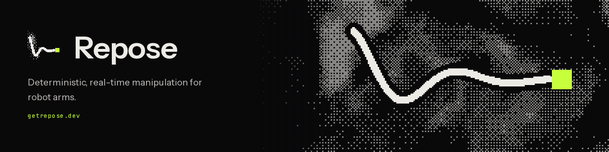

Repose is a manipulation stack for robot arms, built on [Copper](https://github.com/copper-project/copper-rs). Kinematics, collision checking, motion planning, trajectories and control, all `no_std` with zero allocations. Same input, same motion.

| | |
|---|---|
| [**repose**](https://github.com/ReposeRobotics/repose) | Kinematics, collision, motion planning, trajectories and control for copper-rs |
| [**repose-bridges**](https://github.com/ReposeRobotics/repose-bridges) | Copper-native hardware bridges, grouped by manufacturer |
| [**studio**](https://github.com/ReposeRobotics/studio) | Trajectory planning and visualization studio |
| [**meander**](https://github.com/ReposeRobotics/meander) | Deterministic, allocation-free mobile robot navigation |

[Docs](https://getrepose.dev/docs) · [Get started](https://getrepose.dev/get-started) · [Updates](https://getrepose.dev/updates) · [Brand](https://getrepose.dev/brand)
